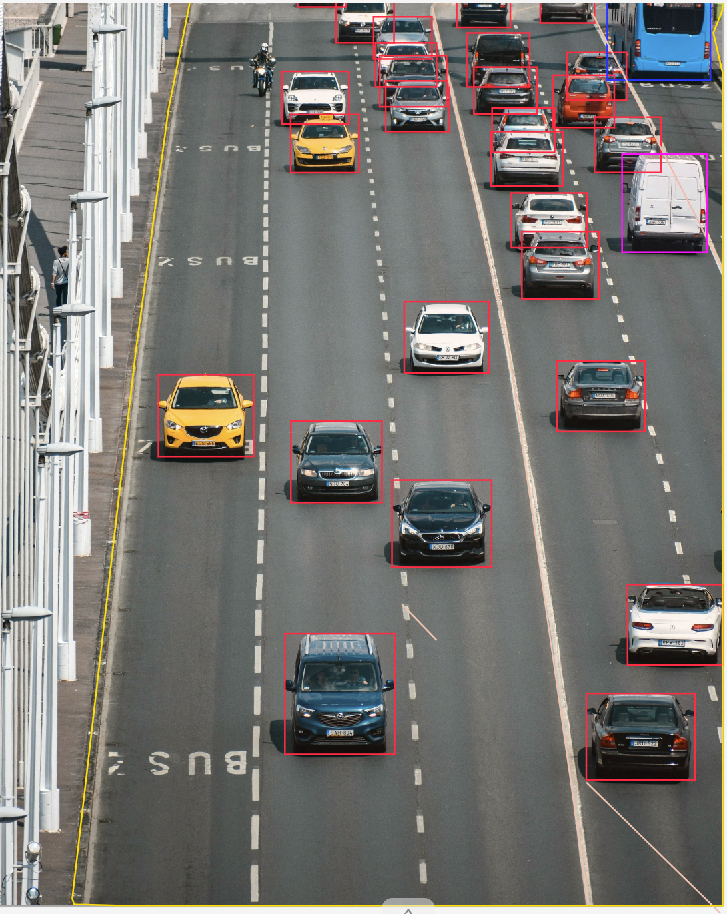
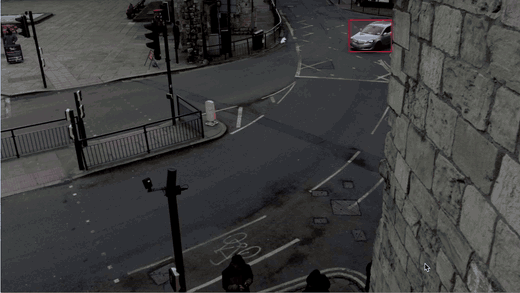

# Projects

**Computer vision data annotation** · CVAT

A collection of my work. Each folder is a self-contained project.

| Project | What it is | Highlights |
|---------|------------|------------|
| [Data Annotation Portfolio](annotation-portfolio) | Images and video I annotated in CVAT, with exported labels, statistics and annotated samples | 3 street scenes · 79 objects · 6 shape types · 611-frame vehicle tracking video |

 

📫 Available for freelance and contract annotation work. Contact me via [GitHub](https://github.com/deepikadhineshkrishnan).
