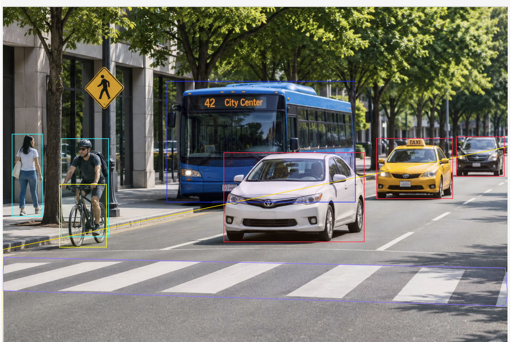
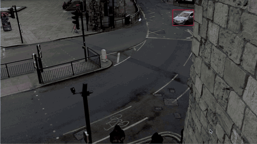

# Data Annotation Portfolio

**Computer vision data annotator** · CVAT · bounding boxes · polygons · polylines · points · ellipses · cuboids · video tracking

I label images and video for machine-learning teams. I follow guidelines closely, keep label sets
clean and consistent, and check my own work before delivery. This repository shows
CVAT projects I have annotated, with the exported labels, previews and statistics.

📫 **Contact:** via [GitHub](https://github.com/deepikadhineshkrishnan) · Available for freelance and contract annotation work

---

## Projects

| # | Project | Annotation types | Scale | Preview |
|---|---------|------------------|-------|---------|
| 1 | [Urban street scenes](projects/01-object-detection-bboxes) | Boxes, polygons, polylines, points, ellipses, cuboids | 3 images · 79 objects |  |
| 4 | [Video object tracking](projects/04-video-object-tracking) | Box tracks, keyframes, interpolation | 611 frames · 4 tracks · 531 boxes |  |

Each project folder has a README with the brief, label schema, guidelines, quality checks,
statistics and annotated samples. The statistics come straight from the CVAT export.
More projects (segmentation, keypoints) are on the way.

## Skills

| Area | Details |
|------|---------|
| Annotation types | Bounding boxes, polygons, polylines, points, ellipses, cuboids, video tracks |
| Tool | CVAT (projects, tasks, label constructor, export) |
| Export formats | CVAT for images / CVAT for video XML (convertible to COCO JSON, YOLO, Pascal VOC, MOT) |
| Quality | Tight boxes, consistent label naming, self-review before export |

## How this repo is built

```
projects/<project>/
├── README.md     # brief, label schema, guidelines, QA, stats + previews (auto-filled)
├── STATS.md      # full statistics generated from the export
├── export/       # CVAT export (annotations XML)
└── previews/     # annotated samples
tools/cvat_showcase.py   # turns a CVAT export into statistics and previews
```

To refresh a project after a new CVAT export: `python3 tools/cvat_showcase.py --all`

## Data & license

All annotations here are my own work. Image sources and credits are listed in each project.
Annotations: [CC BY 4.0](https://creativecommons.org/licenses/by/4.0/) · Code in `tools/`: MIT.
