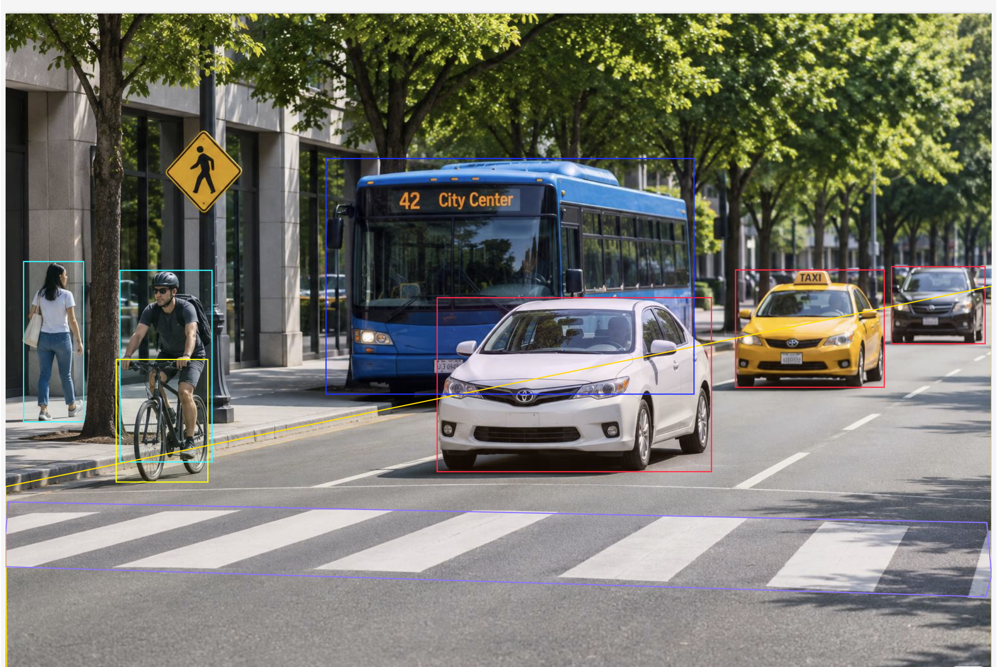
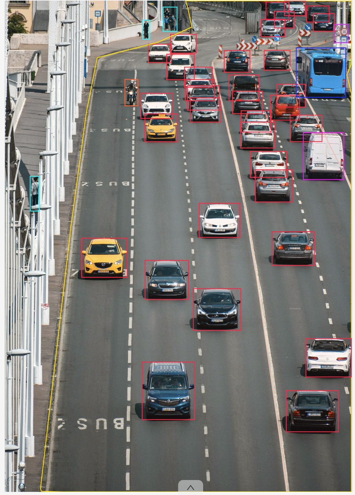
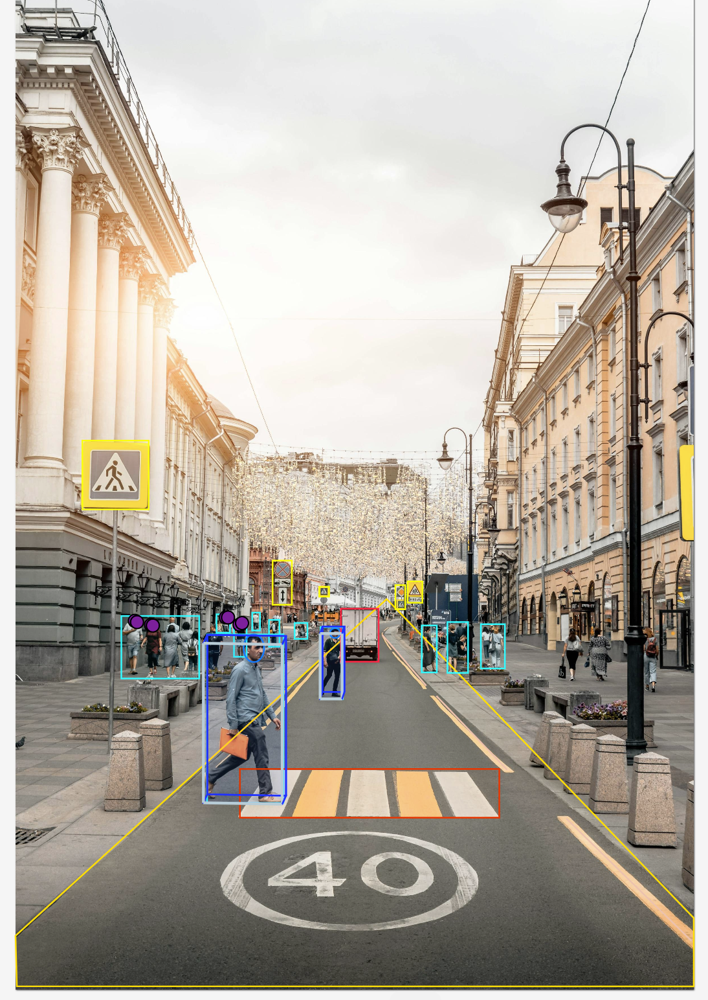

# Urban Street Scenes: Object Detection & Multi-Shape Annotation

| | |
|---|---|
| **Annotation types** | Bounding boxes, polygons, polylines, points, ellipses, cuboids |
| **Tool** | CVAT (cvat.ai cloud) |
| **Export format** | CVAT for images 1.1 (convertible to COCO JSON, YOLO, Pascal VOC) |
| **Scale** | 3 street scenes · 79 objects · 15 labels |
| **Date** | November 2026 |

## Brief

Three urban street photos (a crosswalk with a bus and cyclist, a busy multi-lane road seen
from above, and a pedestrian street) labelled for a perception model of the kind used in
driver-assistance and traffic analysis: vehicles, people, signs, and road layout
(drivable road, lane lines and crosswalks).

## Label schema

| Label | Shape | What it covers |
|---|---|---|
| Car | box | passenger cars and taxis |
| Bus | box | buses |
| Van | box | vans |
| Motorcycle | box | motorcycles (rider included in the box) |
| Bicycle | box | bicycles (the rider is a separate Person) |
| Person | box | pedestrians and cyclists |
| pedestrian | cuboid | 3D box for people close to the camera |
| face-ellipse | ellipse | faces |
| eye-point | points | eye positions |
| sign-label | box | traffic and pedestrian signs (street scene) |
| Traffic Sign | box | traffic signs (highway scene) |
| road | polygon | drivable road surface |
| lane-line | polyline | painted lane and edge markings |
| zebra-road | polygon | crosswalk outline |
| zebra-road-box | box | crosswalk bounding box |

## Guidelines I followed

- Tight boxes touching the outermost visible pixels of each object
- One box per object, including small and distant vehicles in dense traffic (up to 44 objects in one image)
- Cyclists labelled as two objects: **Person** + **Bicycle**
- Road and crosswalk traced as polygons along the visible edges; lane markings as polylines
- Every object in an image labelled before moving on; nothing left half-done

## Quality checks

- Reviewed every image after the first pass, zoomed in, to catch missed small objects
- Cleaned up the label set: merged duplicate crosswalk labels into `zebra-road` / `zebra-road-box` and removed stray lane-lines
- Second review pass: added a missed motorcycle, pedestrians and a sign, and split group boxes on distant cars into one box per car
- Re-exported and re-checked the counts below against the screenshots

## Image credits

Photos from [Unsplash](https://unsplash.com/license) by Christian Wiediger and Keszthelyi Timi;
crosswalk scene (`sample_01`): AI-generated image.

## Statistics

Generated from the CVAT exports in `export/` by `tools/cvat_showcase.py`. Full table in [STATS.md](STATS.md).

<!-- STATS:START -->
| Metric | Value |
|---|---|
| Annotated images | 3 |
| Objects | 79 |
| Avg objects per annotated image | 26.3 |
| Max objects in one image | 44 |
| Marked occluded | 0% |

**Annotations by label**

| Label | Box | Polygon | Polyline | Points | Ellipse | Cuboid | Total |
|---|--:|--:|--:|--:|--:|--:|--:|
| Car | 38 |  |  |  |  |  | 38 |
| Person | 16 |  |  |  |  |  | 16 |
| sign-label | 5 |  |  |  |  |  | 5 |
| road |  | 3 |  |  |  |  | 3 |
| lane-line |  |  | 3 |  |  |  | 3 |
| Bus | 2 |  |  |  |  |  | 2 |
| face-ellipse |  |  |  |  | 2 |  | 2 |
| pedestrian |  |  |  |  |  | 2 | 2 |
| eye-point |  |  |  | 2 |  |  | 2 |
| Bicycle | 1 |  |  |  |  |  | 1 |
| zebra-road |  | 1 |  |  |  |  | 1 |
| zebra-road-box | 1 |  |  |  |  |  | 1 |
| Van | 1 |  |  |  |  |  | 1 |
| Motorcycle | 1 |  |  |  |  |  | 1 |
| Traffic Sign | 1 |  |  |  |  |  | 1 |
<!-- STATS:END -->

## Annotated samples

<!-- PREVIEWS:START -->

 

<!-- PREVIEWS:END -->

## Files

- [`export/annotations.xml`](export/annotations.xml): full CVAT export (labels, attributes, every shape)
- [`previews/`](previews/): rendered samples
- [`STATS.md`](STATS.md): generated statistics
