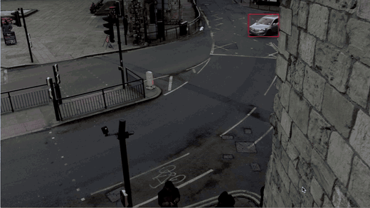
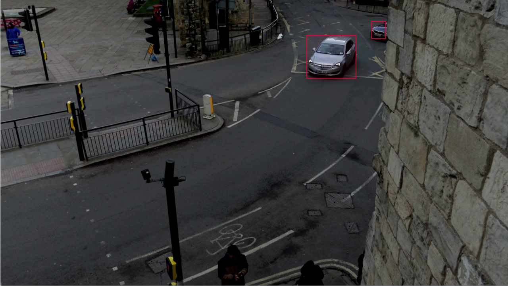
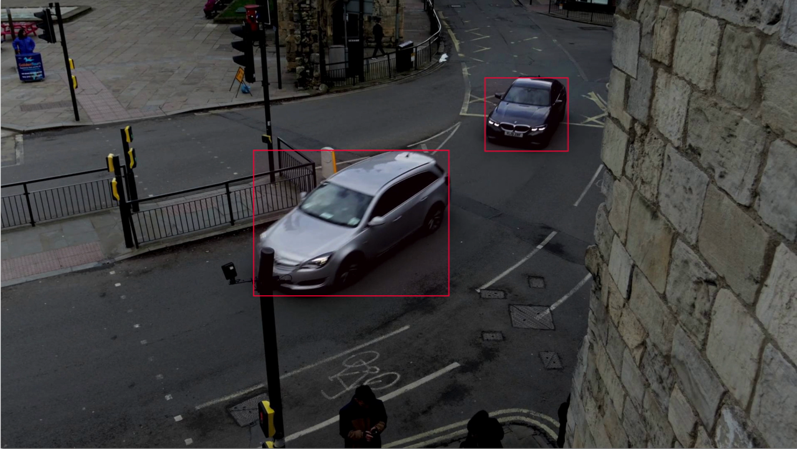

# Video Object Tracking: Vehicles at an Urban Junction

| | |
|---|---|
| **Annotation type** | Rectangle tracks with keyframes and interpolation |
| **Tool** | CVAT (cvat.ai cloud) |
| **Export format** | CVAT for video 1.1 (convertible to MOT, Datumaro) |
| **Scale** | 296-frame clip (25 fps, about 12 s) · 4 vehicle tracks · 531 tracked boxes |
| **Scope** | Vehicles only |
| **Date** | November 2026 |

## Brief

A fixed-camera clip of cars turning through a junction beside a stone wall. Each vehicle is
tracked from the frame it enters to the frame it leaves, as needed for a multi-object
tracking or traffic-counting model.

## Label schema

| Label | Shape | Notes |
|---|---|---|
| Car | box track | every car in view; one track ID per car |

## Guidelines I followed

- One track per vehicle, with the same ID for its whole time on screen
- Keyframes placed where motion changes (turning, speeding up, entering or leaving the frame); CVAT interpolates between them
- Boxes cover the full visible vehicle, including tyres and mirrors
- Vehicles partly hidden by the wall, or motion-blurred at the frame edge, are still tracked
- Track ended with *outside* when the car leaves the frame

## Quality checks

- Stepped through the interpolated frames between keyframes and corrected drift
- Merged split tracks so each car keeps a single ID
- About 1 in 5 boxes is a hand-placed keyframe; the rest are interpolated and reviewed

## Video credit

Source video: Pexels (free to use under the [Pexels license](https://www.pexels.com/license/)).
Preview GIF made from a screen recording of the annotated task in CVAT.

## Statistics

Generated from the CVAT export in `export/` by `tools/cvat_showcase.py`. Full table in [STATS.md](STATS.md).

<!-- STATS:START -->
| Metric | Value |
|---|---|
| Frames in video | 296 |
| Annotated frames | 296 |
| Tracks (unique objects) | 4 |
| Visible shapes across all frames | 531 |
| Manually placed keyframes | 108 (20% of shapes; the rest interpolated and reviewed) |
| Marked occluded | 0% |

**Annotations by label**

| Label | Shape | Tracks | Avg track length (frames) | Keyframes |
|---|---|--:|--:|--:|
| Car | Box | 4 | 132.8 | 108 |
<!-- STATS:END -->

## Annotated samples

<!-- PREVIEWS:START -->

 

<!-- PREVIEWS:END -->

## Files

- [`export/annotations.xml`](export/annotations.xml): full CVAT export (labels, attributes, every shape)
- [`previews/`](previews/): rendered samples
- [`STATS.md`](STATS.md): generated statistics
